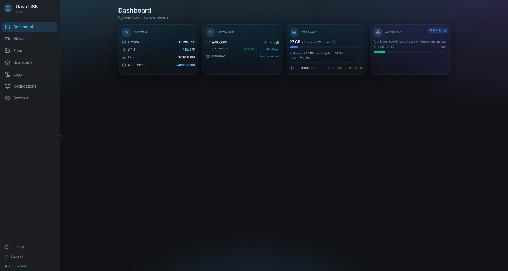
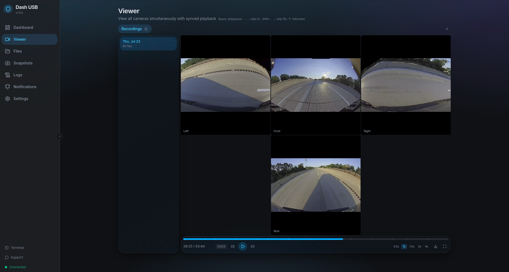
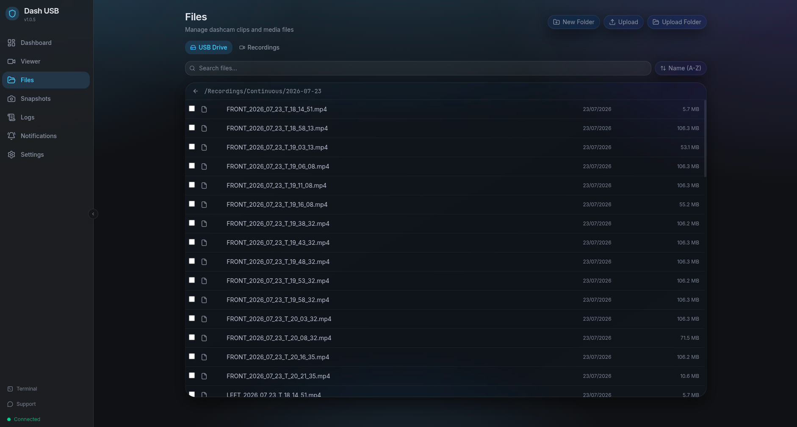
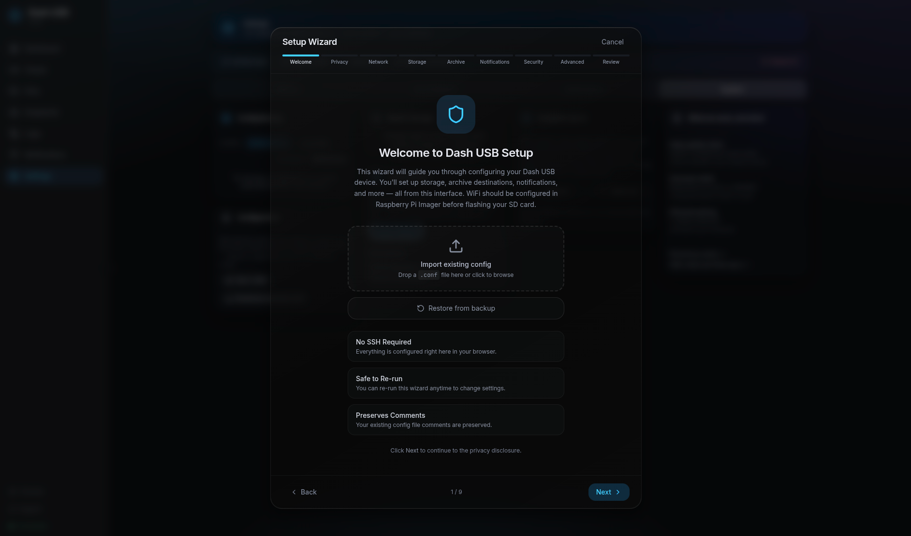
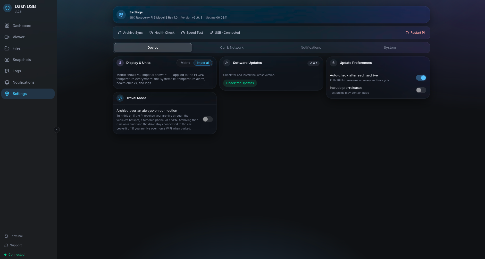

<h1 align="center">Dash USB</h1>

<p align="center">
  <strong>Turn a Raspberry Pi into a smart USB drive for your GM vehicle's built-in dashcam.</strong><br>
  Break the rolling 2-hour limit. Auto-archive everything. Modern web UI.
</p>

<p align="center">
  <a href="https://github.com/Sentry-Six/Dash-USB/releases/latest"></a>
  <a href="https://discord.gg/9QZEzVwdnt"></a>
  <a href="LICENSE"></a>
</p>

<p align="center">
  
</p>

---

## What it does

GM's Surround Vision Recorder (the built-in dashcam on newer EVs and ICE vehicles)
records four cameras — front, left, right, rear — to a USB drive you plug into any
USB-C port. But it's software-limited to a **rolling 2 hours** of footage, no matter
how big the drive is.

Dash USB defeats that limit:

- **Plugs into your car's USB-C port** and pretends to be a compliant FAT32 drive.
- **Continuously snapshots** the recordings the car writes — before the car's rolling
  delete reaches them.
- **Archives clips automatically** to your NAS, cloud, or wherever — over WiFi, in the
  background. Your footage history is limited by your storage, not by GM's firmware.
- **Multi-camera viewer** — synchronized 4-camera playback in a modern web UI
  (interior camera on 2027+ models supported).
- **Privacy-first.** No fingerprinting by default; everything sensitive is opt-in.

Dash USB is the GM sibling of [Sentry USB](https://github.com/Sentry-Six/Sentry-USB-Rusty)
(for Tesla), from the [Sentry Six](https://sentry-six.com) project. It's built around a
**vehicle profile** system — support for further brands that record to USB mass storage
can be added as data, not code. Not affiliated with General Motors.

---

## Screenshots

<p align="center">
  <br>
  <em>Synchronized four-camera playback of the footage your car recorded, kept as long as you want.</em>
</p>

<p align="center">
  <br>
  <em>Every recording the car wrote, retained past the 2-hour limit and browsable in place.</em>
</p>

<p align="center">
  <br>
  <em>The 9-step setup wizard. No SSH, no config files.</em>
</p>

<p align="center">
  <br>
  <em>Everything reconfigurable from the browser, including Travel Mode for archiving over the vehicle hotspot.</em>
</p>

---

## Vehicle requirements

Your vehicle needs GM's Surround Vision Recorder feature (rolling dashcam recording to
USB). GM's listed drive requirements — FAT32, ≥64 GB with 32 GB available — are what
the virtual drive presents by default.

## Hardware

| Tier | Boards | Notes |
|------|--------|-------|
| **Recommended** | Raspberry Pi 4B, Raspberry Pi 5 | USB 2.0 OTG — fastest archiving, smoothest UI |
| **Should work** | Raspberry Pi Zero 2 W, Raspberry Pi 3 Model A+ | USB 2.0 OTG, slower archive speeds |

> The Pi 3 Model **B** and **B+** will not work. Their single USB channel is wired
> through an onboard hub chip for Ethernet and the four USB-A ports, leaving the
> micro-USB port power-only with no OTG. Only the 3A+, which omits that chip, can act
> as a USB gadget.

Plus a **256 GB+ high-endurance MicroSD card** (512 GB recommended — GM records
~5 GB per hour of driving, all of which Dash USB retains) and a **USB-C data cable**.

## Install

On a Pi already running **Raspberry Pi OS Lite (64-bit)**:

```bash
sudo apt update && sudo apt upgrade -y
sudo -i
curl -fsSL https://raw.githubusercontent.com/Sentry-Six/Dash-USB/main/install-pi.sh | bash
```

Then open `http://dashusb.local` in a browser and the setup wizard takes you the rest
of the way.

---

## Privacy

Here's everything Dash USB sends to Sentry Six services:

| When | What | Identifier? |
|---|---|---|
| When you check for updates | Software version, CPU arch, board model, update status | None by default; a salted hash of the board serial (or `/etc/machine-id`) if you opt in |
| First startup, before setup (retried on later boots if needed) | Empty ping (no body) | None; the server keeps a daily count |
| Time zone `auto` | A lookup to `sentryusb.com`, which sees your IP | None |
| Support page (if used) | Your messages and attachments, relayed to a private Discord thread for staff | Ticket only |
| Sentry Connect push pairing (if used) | Random pairing ID and secret, the Pi's hostname, and notification text relayed to Apple | Random ID |

A device ID is sent only if you opt in under
**Settings → System → Analytics opt-in** (default: off). Opted-in checks are
stored with the version, architecture and board model, and a private
maintainers' Discord channel gets the version, architecture, board model and
update status. Full details are in [`wiki/Privacy.md`](wiki/Privacy.md).

---

## Build from source

Prerequisites: Rust stable, Node 20.19+ or 22.12+, and `cross` (`cargo install cross`).

```bash
# Web UI
cd web && npm ci && npm run build && cd ..
rm -rf crates/sentryusb/static && cp -r web/dist crates/sentryusb/static

# Binaries (aarch64)
cross build --release --target aarch64-unknown-linux-gnu -p sentryusb
```

See [BUILD.md](BUILD.md) for details.

---

## Based on

A white-label of [Sentry-USB-Rusty](https://github.com/Sentry-Six/Sentry-USB-Rusty)
(Rust rewrite of the original Go [`Scottmg1/Sentry-USB`](https://github.com/Scottmg1/Sentry-USB)),
itself descended from [TeslaUSB](https://github.com/marcone/teslausb) by marcone and
contributors.

## Community

- **Discord** — [discord.gg/9QZEzVwdnt](https://discord.gg/9QZEzVwdnt) — fastest help, real humans
- **Issues** — [github.com/Sentry-Six/Dash-USB/issues](https://github.com/Sentry-Six/Dash-USB/issues) — reproducible bugs
- **Site** — [sentry-six.com](https://sentry-six.com)

## License

PolyForm Noncommercial 1.0.0 — free for any noncommercial use; commercial use
requires a separate license. See [LICENSE](LICENSE). Some bundled shell scripts
are derived from [TeslaUSB](https://github.com/marcone/teslausb) and remain
under the MIT License; see [NOTICE](NOTICE) for the file-by-file breakdown.

This is source-available software, not open source — commercial use is not
permitted under this license. To inquire about a commercial license, contact
the authors.
